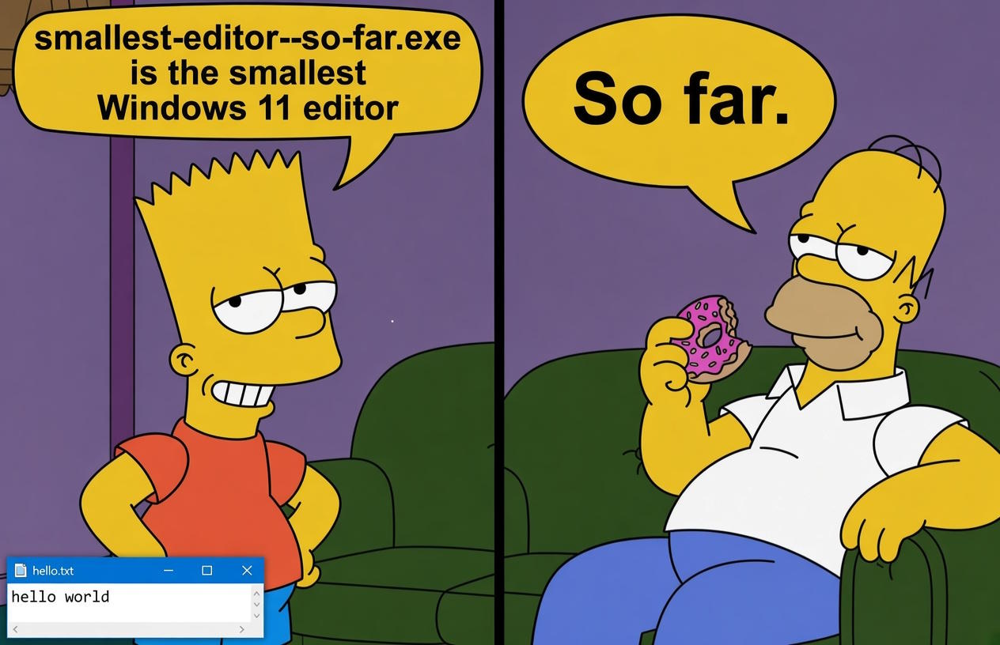

# smallest-editor--so-far

This repo is vibespired by Atto, the tiny (~48 KB) terminal-based text editor added to NetBSD on October 26, 2026.

The goal is the **smallest possible Windows text editor**, measured in bytes of the complete executable.

Current size: **912 bytes**.



## Requirements

- R1. Editor can load and save a text file below a defined size. User selects file name.
- R2. The user edits text in a window: typing inserts characters at the caret, and the arrow, Backspace, and Delete keys move the caret and remove characters.
- R3. The executable runs on a stock 64-bit Windows 11 installation without any other file installed first.


## Use

Run `smallest-editor--so-far.exe`. In the opening file selector, choose an existing file or type a new name to start empty. Cancel exits.

The title bar shows the full path chosen at startup.

Edit the text and press **Ctrl+S** to save. If saving fails, the file selector opens again so you can choose another path; Cancel returns to editing. Closing the window exits without saving or prompting.

Files larger than 3,145,727 bytes are refused.

## How it stays small

Windows supplies the editing through a single built-in `EDIT` control. The program adds file selection, loading, saving, and a message loop.

[`smallest-editor--so-far.s`](smallest-editor--so-far.s) defines the entire 32-bit executable in assembly, including its PE headers and import tables. The build assembles it and extracts the bytes directly from the object file. No linker or bundled runtime is needed.

## Build and test

Install clang from LLVM MinGW and make sure it is on `PATH`:

```powershell
winget install --id MartinStorsjo.LLVM-MinGW.UCRT
```

Then build and test from PowerShell:

```powershell
.\Build-Editor.ps1
.\Test-Editor.ps1
```

The build writes `smallest-editor--so-far.exe` and prints its byte count. The test script drives the editor with Win32 messages through 23 checks covering file selection, editing, saving, failed-save recovery, process exit, a 1,000,000-byte file, and a 5,000,000-byte file that the editor refuses.
