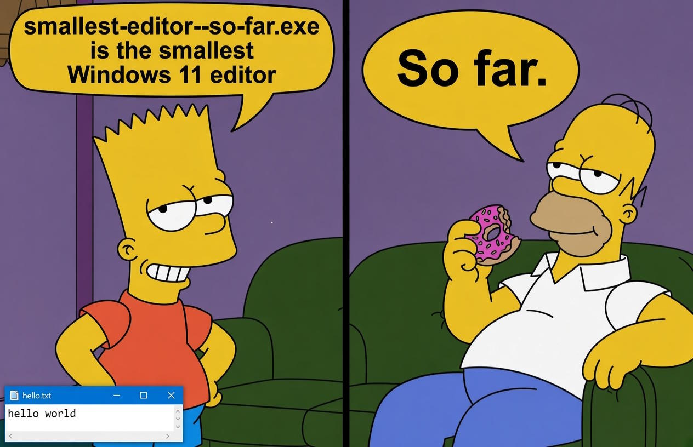

# smallest-editor--so-far

The goal is the **smallest possible Windows text editor**, measured by the size of the complete executable. Vibespired by Atto, the name of a tiny terminal editor [added to NetBSD on October 26, 2026](https://mail-index.netbsd.org/source-changes/2026/10/26/msg164822.html).

| Date | Size | Author |
| --- | ---: | --- |
| Nov 17, 2026 | **1,024 bytes** | Astra 6.2 xhigh |
| Nov 4, 2026 | 1,136 bytes | Claude Opus 5.5 |



## Requirements

- **R1.** The editor must load and save any user-selected text file of 1 MiB or less.
- **R2.** Support typing, arrow keys, Backspace, and Delete in a window.
- **R3.** Run on stock 64-bit Windows 11 with no installation required.

## Use

Run `smallest-editor--so-far.exe`. Choose an existing file or type a new name.

The editor saves one second after your last change or when you close the window with edits pending. A new file is created on its first save. If autosave fails, choose another path or cancel to keep editing.

## Build and test

Windows handles editing through one built-in `EDIT` control.

Install LLVM MinGW to get `clang` on your `PATH`.

```powershell
winget install --id MartinStorsjo.LLVM-MinGW.UCRT
```

From PowerShell, build the executable, print its size, and run some tests.

```powershell
.\Build-Editor.ps1
.\Test-Editor.ps1
```
